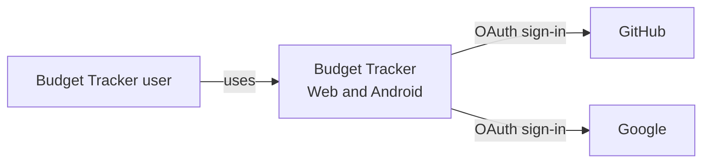
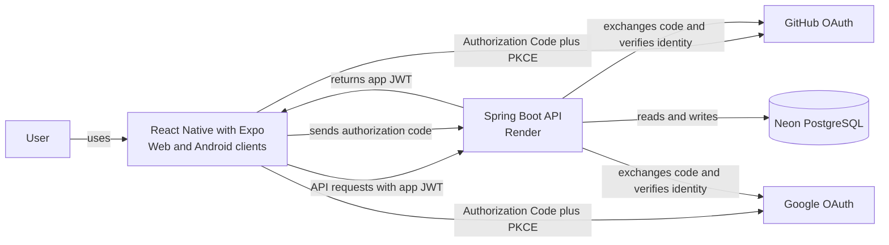

# Budget Tracker Architecture

## System context

The user accesses Budget Tracker through its web or Android client and can sign in with GitHub or Google.

## Containers

The web and Android clients use the same React Native with Expo codebase. The Spring Boot API runs on Render and stores application data in Neon PostgreSQL.

## Authentication flow

The client uses OAuth Authorization Code with PKCE to sign in with a provider. It sends the authorization code to the API. The API verifies the user with the provider, creates or finds the user account, and returns an app JWT. The client sends that JWT with later API requests.

The project guide plans GitHub sign-in on web first, then Google sign-in on web and Android. Update this document if the team’s final implementation plan changes.
